<!-- Generated by Documenter Agent v0.1.0
     Timestamp: 2026-11-20T16:30:17.239665+00:00
     Source: a50f11c65eea0cb0a9bc9e3ce1b10fc980e20766
     Keywords: CancelVoyageRequest, ChangeVoyageDestinationRequest, CommandResponse, ConflictErrorResponse, ContainerLoadedHistoryEntry, ContainerUnloadedHistoryEntry, Country, DivertShipRequest, DockShipRequest, ErrorResponse, Identifier, InternalErrorResponse, LoadContainerRequest, Name, NotFoundErrorResponse
-->

# Data Model

<!-- provenance -->
> **Extracted fact** from the code at commit `a50f11c`, produced by static analysis with no AI model. Safe to rely on.

Deterministically extracted from schema sources (SQL, Pydantic, TypeScript, OpenAPI). No LLM was used to produce this map.

```mermaid
erDiagram
    event_journal {
        TEXT aggregate_id "required"
        BIGINT version "required"
        TEXT event_payload "required"
    }
    event_journal_position {
        BOOLEAN singleton
        BIGINT next_position "required"
    }
    ship_overview {
        TEXT ship_id
        TEXT name "required"
        TEXT status "required"
        TEXT current_port_name
        TEXT current_port_country
    }
    ship_overview_checkpoint {
        BOOLEAN singleton
        BIGINT position "required"
    }
    Identifier {
    }
    Name {
    }
    Country {
    }
    VoyageChangeReason {
    }
    Port {
        Name name "required"
        Country country "required"
    }
    RegisterShipRequest {
        Identifier id
        Name name "required"
        Port port "required"
    }
    LoadContainerRequest {
        Identifier id "required"
        Identifier containerId "required"
        Identifier cargoReference "required"
        Name description "required"
    }
    UnloadContainerRequest {
        Identifier id "required"
        Identifier containerId "required"
    }
    PlanVoyageRequest {
        Identifier id "required"
        Port destination "required"
    }
    ChangeVoyageDestinationRequest {
        Identifier id "required"
        Port destination "required"
        VoyageChangeReason reason "required"
    }
    CancelVoyageRequest {
        Identifier id "required"
        VoyageChangeReason reason "required"
    }
    ShipCommandRequest {
        Identifier id "required"
    }
    DivertShipRequest {
        Identifier id "required"
        Port destination "required"
        VoyageChangeReason reason "required"
    }
    DockShipRequest {
        Identifier id "required"
        Port port "required"
    }
    PingResponse {
        integer status "required"
        string dateTime "required"
    }
    CommandResponse {
        integer status "required"
        string dateTime "required"
    }
    RegisterShipResponse {
        integer status "required"
        string dateTime "required"
        object body
    }
    ErrorResponse {
        integer status "required"
        string error "required"
        string dateTime "required"
    }
    ValidationErrorResponse {
    }
    NotFoundErrorResponse {
    }
    ConflictErrorResponse {
    }
    InternalErrorResponse {
    }
    ShipHistoryResponse {
        integer status "required"
        string dateTime "required"
        ShipHistory body "required"
    }
    ShipOverviewStatus {
    }
    ShipOverview {
        Identifier shipId "required"
        Name name "required"
        ShipOverviewStatus status "required"
        Port currentPort
    }
    ShipOverviewResponse {
        integer status "required"
        string dateTime "required"
        ShipOverview body "required"
    }
    ShipOverviewListResponse {
        integer status "required"
        string dateTime "required"
        object body "required"
    }
    ShipHistory {
        Identifier shipId "required"
        array history "required"
    }
    ShipRegisteredHistoryEntry {
        string kind "required"
        string occurredAt "required"
        Name name "required"
        Port port "required"
    }
    ShipArrivedHistoryEntry {
        string kind "required"
        string occurredAt "required"
        Port port "required"
    }
    ShipDepartedHistoryEntry {
        string kind "required"
        string occurredAt "required"
    }
    VoyagePlannedHistoryEntry {
        string kind "required"
        string occurredAt "required"
        Port origin "required"
        Port destination "required"
    }
    VoyageDivertedHistoryEntry {
        string kind "required"
        string occurredAt "required"
        Port previousDestination "required"
        Port destination "required"
        string reason "required"
    }
    VoyageDestinationChangedHistoryEntry {
        string kind "required"
        string occurredAt "required"
        Port previousDestination "required"
        Port destination "required"
        string reason "required"
    }
    VoyageCancelledHistoryEntry {
        string kind "required"
        string occurredAt "required"
        Port origin "required"
        Port destination "required"
        string reason "required"
    }
    ContainerLoadedHistoryEntry {
        string kind "required"
        string occurredAt "required"
        Identifier containerId "required"
        Identifier cargoReference "required"
        Name description "required"
    }
    ContainerUnloadedHistoryEntry {
        string kind "required"
        string occurredAt "required"
        Identifier containerId "required"
        Identifier cargoReference "required"
        Name description "required"
    }
    Port }o--o{ Name : "reference"
    Port }o--o{ Country : "reference"
    RegisterShipRequest }o--o{ Identifier : "reference"
    RegisterShipRequest }o--o{ Name : "reference"
    RegisterShipRequest }o--o{ Port : "reference"
    LoadContainerRequest }o--o{ Identifier : "reference"
    LoadContainerRequest }o--o{ Identifier : "reference"
    LoadContainerRequest }o--o{ Identifier : "reference"
    LoadContainerRequest }o--o{ Name : "reference"
    UnloadContainerRequest }o--o{ Identifier : "reference"
    UnloadContainerRequest }o--o{ Identifier : "reference"
    PlanVoyageRequest }o--o{ Identifier : "reference"
    PlanVoyageRequest }o--o{ Port : "reference"
    ChangeVoyageDestinationRequest }o--o{ Identifier : "reference"
    ChangeVoyageDestinationRequest }o--o{ Port : "reference"
    ChangeVoyageDestinationRequest }o--o{ VoyageChangeReason : "reference"
    CancelVoyageRequest }o--o{ Identifier : "reference"
    CancelVoyageRequest }o--o{ VoyageChangeReason : "reference"
    ShipCommandRequest }o--o{ Identifier : "reference"
    DivertShipRequest }o--o{ Identifier : "reference"
    DivertShipRequest }o--o{ Port : "reference"
    DivertShipRequest }o--o{ VoyageChangeReason : "reference"
    DockShipRequest }o--o{ Identifier : "reference"
    DockShipRequest }o--o{ Port : "reference"
    ShipHistoryResponse }o--o{ ShipHistory : "reference"
    ShipOverview }o--o{ Identifier : "reference"
    ShipOverview }o--o{ Name : "reference"
    ShipOverview }o--o{ ShipOverviewStatus : "reference"
    ShipOverview }o--o{ Port : "reference"
    ShipOverviewResponse }o--o{ ShipOverview : "reference"
    ShipHistory }o--o{ Identifier : "reference"
    ShipRegisteredHistoryEntry }o--o{ Name : "reference"
    ShipRegisteredHistoryEntry }o--o{ Port : "reference"
    ShipArrivedHistoryEntry }o--o{ Port : "reference"
    VoyagePlannedHistoryEntry }o--o{ Port : "reference"
    VoyagePlannedHistoryEntry }o--o{ Port : "reference"
    VoyageDivertedHistoryEntry }o--o{ Port : "reference"
    VoyageDivertedHistoryEntry }o--o{ Port : "reference"
    VoyageDestinationChangedHistoryEntry }o--o{ Port : "reference"
    VoyageDestinationChangedHistoryEntry }o--o{ Port : "reference"
    VoyageCancelledHistoryEntry }o--o{ Port : "reference"
    VoyageCancelledHistoryEntry }o--o{ Port : "reference"
    ContainerLoadedHistoryEntry }o--o{ Identifier : "reference"
    ContainerLoadedHistoryEntry }o--o{ Identifier : "reference"
    ContainerLoadedHistoryEntry }o--o{ Name : "reference"
    ContainerUnloadedHistoryEntry }o--o{ Identifier : "reference"
    ContainerUnloadedHistoryEntry }o--o{ Identifier : "reference"
    ContainerUnloadedHistoryEntry }o--o{ Name : "reference"
```

## Entities

### event_journal
_Source: sql (/tmp/documenter-49d741d9-hibbfh6t/repo/modules/ships-n-cargo/src/adapters/outbound/persistence/postgresql/schema/001-event-journal.sql)_

| Field | Type | Nullable |
| --- | --- | --- |
| aggregate_id | `TEXT` | no |
| version | `BIGINT` | no |
| event_payload | `TEXT` | no |

### event_journal_position
_Source: sql (/tmp/documenter-49d741d9-hibbfh6t/repo/modules/ships-n-cargo/src/adapters/outbound/persistence/postgresql/schema/002-global-feed.sql)_

| Field | Type | Nullable |
| --- | --- | --- |
| singleton | `BOOLEAN` | yes |
| next_position | `BIGINT` | no |

### ship_overview
_Source: sql (/tmp/documenter-49d741d9-hibbfh6t/repo/modules/ships-n-cargo/src/adapters/outbound/persistence/postgresql/schema/003-ship-overview.sql)_

| Field | Type | Nullable |
| --- | --- | --- |
| ship_id | `TEXT` | yes |
| name | `TEXT` | no |
| status | `TEXT` | no |
| current_port_name | `TEXT` | yes |
| current_port_country | `TEXT` | yes |

### ship_overview_checkpoint
_Source: sql (/tmp/documenter-49d741d9-hibbfh6t/repo/modules/ships-n-cargo/src/adapters/outbound/persistence/postgresql/schema/003-ship-overview.sql)_

| Field | Type | Nullable |
| --- | --- | --- |
| singleton | `BOOLEAN` | yes |
| position | `BIGINT` | no |

### Identifier
_Source: openapi (/tmp/documenter-49d741d9-hibbfh6t/repo/modules/ships-n-cargo/src/adapters/inbound/http/openapi.yaml)_

_No fields extracted._

### Name
_Source: openapi (/tmp/documenter-49d741d9-hibbfh6t/repo/modules/ships-n-cargo/src/adapters/inbound/http/openapi.yaml)_

_No fields extracted._

### Country
_Source: openapi (/tmp/documenter-49d741d9-hibbfh6t/repo/modules/ships-n-cargo/src/adapters/inbound/http/openapi.yaml)_

_No fields extracted._

### VoyageChangeReason
_Source: openapi (/tmp/documenter-49d741d9-hibbfh6t/repo/modules/ships-n-cargo/src/adapters/inbound/http/openapi.yaml)_

_No fields extracted._

### Port
_Source: openapi (/tmp/documenter-49d741d9-hibbfh6t/repo/modules/ships-n-cargo/src/adapters/inbound/http/openapi.yaml)_

| Field | Type | Nullable |
| --- | --- | --- |
| name | `Name` | no |
| country | `Country` | no |

### RegisterShipRequest
_Source: openapi (/tmp/documenter-49d741d9-hibbfh6t/repo/modules/ships-n-cargo/src/adapters/inbound/http/openapi.yaml)_

| Field | Type | Nullable |
| --- | --- | --- |
| id | `Identifier` | yes |
| name | `Name` | no |
| port | `Port` | no |

### LoadContainerRequest
_Source: openapi (/tmp/documenter-49d741d9-hibbfh6t/repo/modules/ships-n-cargo/src/adapters/inbound/http/openapi.yaml)_

| Field | Type | Nullable |
| --- | --- | --- |
| id | `Identifier` | no |
| containerId | `Identifier` | no |
| cargoReference | `Identifier` | no |
| description | `Name` | no |

### UnloadContainerRequest
_Source: openapi (/tmp/documenter-49d741d9-hibbfh6t/repo/modules/ships-n-cargo/src/adapters/inbound/http/openapi.yaml)_

| Field | Type | Nullable |
| --- | --- | --- |
| id | `Identifier` | no |
| containerId | `Identifier` | no |

### PlanVoyageRequest
_Source: openapi (/tmp/documenter-49d741d9-hibbfh6t/repo/modules/ships-n-cargo/src/adapters/inbound/http/openapi.yaml)_

| Field | Type | Nullable |
| --- | --- | --- |
| id | `Identifier` | no |
| destination | `Port` | no |

### ChangeVoyageDestinationRequest
_Source: openapi (/tmp/documenter-49d741d9-hibbfh6t/repo/modules/ships-n-cargo/src/adapters/inbound/http/openapi.yaml)_

| Field | Type | Nullable |
| --- | --- | --- |
| id | `Identifier` | no |
| destination | `Port` | no |
| reason | `VoyageChangeReason` | no |

### CancelVoyageRequest
_Source: openapi (/tmp/documenter-49d741d9-hibbfh6t/repo/modules/ships-n-cargo/src/adapters/inbound/http/openapi.yaml)_

| Field | Type | Nullable |
| --- | --- | --- |
| id | `Identifier` | no |
| reason | `VoyageChangeReason` | no |

### ShipCommandRequest
_Source: openapi (/tmp/documenter-49d741d9-hibbfh6t/repo/modules/ships-n-cargo/src/adapters/inbound/http/openapi.yaml)_

| Field | Type | Nullable |
| --- | --- | --- |
| id | `Identifier` | no |

### DivertShipRequest
_Source: openapi (/tmp/documenter-49d741d9-hibbfh6t/repo/modules/ships-n-cargo/src/adapters/inbound/http/openapi.yaml)_

| Field | Type | Nullable |
| --- | --- | --- |
| id | `Identifier` | no |
| destination | `Port` | no |
| reason | `VoyageChangeReason` | no |

### DockShipRequest
_Source: openapi (/tmp/documenter-49d741d9-hibbfh6t/repo/modules/ships-n-cargo/src/adapters/inbound/http/openapi.yaml)_

| Field | Type | Nullable |
| --- | --- | --- |
| id | `Identifier` | no |
| port | `Port` | no |

### PingResponse
_Source: openapi (/tmp/documenter-49d741d9-hibbfh6t/repo/modules/ships-n-cargo/src/adapters/inbound/http/openapi.yaml)_

| Field | Type | Nullable |
| --- | --- | --- |
| status | `integer` | no |
| dateTime | `string` | no |

### CommandResponse
_Source: openapi (/tmp/documenter-49d741d9-hibbfh6t/repo/modules/ships-n-cargo/src/adapters/inbound/http/openapi.yaml)_

| Field | Type | Nullable |
| --- | --- | --- |
| status | `integer` | no |
| dateTime | `string` | no |

### RegisterShipResponse
_Source: openapi (/tmp/documenter-49d741d9-hibbfh6t/repo/modules/ships-n-cargo/src/adapters/inbound/http/openapi.yaml)_

| Field | Type | Nullable |
| --- | --- | --- |
| status | `integer` | no |
| dateTime | `string` | no |
| body | `object` | yes |

### ErrorResponse
_Source: openapi (/tmp/documenter-49d741d9-hibbfh6t/repo/modules/ships-n-cargo/src/adapters/inbound/http/openapi.yaml)_

| Field | Type | Nullable |
| --- | --- | --- |
| status | `integer` | no |
| error | `string` | no |
| dateTime | `string` | no |

### ValidationErrorResponse
_Source: openapi (/tmp/documenter-49d741d9-hibbfh6t/repo/modules/ships-n-cargo/src/adapters/inbound/http/openapi.yaml)_

_No fields extracted._

### NotFoundErrorResponse
_Source: openapi (/tmp/documenter-49d741d9-hibbfh6t/repo/modules/ships-n-cargo/src/adapters/inbound/http/openapi.yaml)_

_No fields extracted._

### ConflictErrorResponse
_Source: openapi (/tmp/documenter-49d741d9-hibbfh6t/repo/modules/ships-n-cargo/src/adapters/inbound/http/openapi.yaml)_

_No fields extracted._

### InternalErrorResponse
_Source: openapi (/tmp/documenter-49d741d9-hibbfh6t/repo/modules/ships-n-cargo/src/adapters/inbound/http/openapi.yaml)_

_No fields extracted._

### ShipHistoryResponse
_Source: openapi (/tmp/documenter-49d741d9-hibbfh6t/repo/modules/ships-n-cargo/src/adapters/inbound/http/openapi.yaml)_

| Field | Type | Nullable |
| --- | --- | --- |
| status | `integer` | no |
| dateTime | `string` | no |
| body | `ShipHistory` | no |

### ShipOverviewStatus
_Source: openapi (/tmp/documenter-49d741d9-hibbfh6t/repo/modules/ships-n-cargo/src/adapters/inbound/http/openapi.yaml)_

_No fields extracted._

### ShipOverview
_Source: openapi (/tmp/documenter-49d741d9-hibbfh6t/repo/modules/ships-n-cargo/src/adapters/inbound/http/openapi.yaml)_

| Field | Type | Nullable |
| --- | --- | --- |
| shipId | `Identifier` | no |
| name | `Name` | no |
| status | `ShipOverviewStatus` | no |
| currentPort | `Port` | yes |

### ShipOverviewResponse
_Source: openapi (/tmp/documenter-49d741d9-hibbfh6t/repo/modules/ships-n-cargo/src/adapters/inbound/http/openapi.yaml)_

| Field | Type | Nullable |
| --- | --- | --- |
| status | `integer` | no |
| dateTime | `string` | no |
| body | `ShipOverview` | no |

### ShipOverviewListResponse
_Source: openapi (/tmp/documenter-49d741d9-hibbfh6t/repo/modules/ships-n-cargo/src/adapters/inbound/http/openapi.yaml)_

| Field | Type | Nullable |
| --- | --- | --- |
| status | `integer` | no |
| dateTime | `string` | no |
| body | `object` | no |

### ShipHistory
_Source: openapi (/tmp/documenter-49d741d9-hibbfh6t/repo/modules/ships-n-cargo/src/adapters/inbound/http/openapi.yaml)_

| Field | Type | Nullable |
| --- | --- | --- |
| shipId | `Identifier` | no |
| history | `array` | no |

### ShipRegisteredHistoryEntry
_Source: openapi (/tmp/documenter-49d741d9-hibbfh6t/repo/modules/ships-n-cargo/src/adapters/inbound/http/openapi.yaml)_

| Field | Type | Nullable |
| --- | --- | --- |
| kind | `string` | no |
| occurredAt | `string` | no |
| name | `Name` | no |
| port | `Port` | no |

### ShipArrivedHistoryEntry
_Source: openapi (/tmp/documenter-49d741d9-hibbfh6t/repo/modules/ships-n-cargo/src/adapters/inbound/http/openapi.yaml)_

| Field | Type | Nullable |
| --- | --- | --- |
| kind | `string` | no |
| occurredAt | `string` | no |
| port | `Port` | no |

### ShipDepartedHistoryEntry
_Source: openapi (/tmp/documenter-49d741d9-hibbfh6t/repo/modules/ships-n-cargo/src/adapters/inbound/http/openapi.yaml)_

| Field | Type | Nullable |
| --- | --- | --- |
| kind | `string` | no |
| occurredAt | `string` | no |

### VoyagePlannedHistoryEntry
_Source: openapi (/tmp/documenter-49d741d9-hibbfh6t/repo/modules/ships-n-cargo/src/adapters/inbound/http/openapi.yaml)_

| Field | Type | Nullable |
| --- | --- | --- |
| kind | `string` | no |
| occurredAt | `string` | no |
| origin | `Port` | no |
| destination | `Port` | no |

### VoyageDivertedHistoryEntry
_Source: openapi (/tmp/documenter-49d741d9-hibbfh6t/repo/modules/ships-n-cargo/src/adapters/inbound/http/openapi.yaml)_

| Field | Type | Nullable |
| --- | --- | --- |
| kind | `string` | no |
| occurredAt | `string` | no |
| previousDestination | `Port` | no |
| destination | `Port` | no |
| reason | `string` | no |

### VoyageDestinationChangedHistoryEntry
_Source: openapi (/tmp/documenter-49d741d9-hibbfh6t/repo/modules/ships-n-cargo/src/adapters/inbound/http/openapi.yaml)_

| Field | Type | Nullable |
| --- | --- | --- |
| kind | `string` | no |
| occurredAt | `string` | no |
| previousDestination | `Port` | no |
| destination | `Port` | no |
| reason | `string` | no |

### VoyageCancelledHistoryEntry
_Source: openapi (/tmp/documenter-49d741d9-hibbfh6t/repo/modules/ships-n-cargo/src/adapters/inbound/http/openapi.yaml)_

| Field | Type | Nullable |
| --- | --- | --- |
| kind | `string` | no |
| occurredAt | `string` | no |
| origin | `Port` | no |
| destination | `Port` | no |
| reason | `string` | no |

### ContainerLoadedHistoryEntry
_Source: openapi (/tmp/documenter-49d741d9-hibbfh6t/repo/modules/ships-n-cargo/src/adapters/inbound/http/openapi.yaml)_

| Field | Type | Nullable |
| --- | --- | --- |
| kind | `string` | no |
| occurredAt | `string` | no |
| containerId | `Identifier` | no |
| cargoReference | `Identifier` | no |
| description | `Name` | no |

### ContainerUnloadedHistoryEntry
_Source: openapi (/tmp/documenter-49d741d9-hibbfh6t/repo/modules/ships-n-cargo/src/adapters/inbound/http/openapi.yaml)_

| Field | Type | Nullable |
| --- | --- | --- |
| kind | `string` | no |
| occurredAt | `string` | no |
| containerId | `Identifier` | no |
| cargoReference | `Identifier` | no |
| description | `Name` | no |

## API Endpoints

| Method | Path | Request | Response |
| --- | --- | --- | --- |
| GET | `/` | — | PingResponse |
| GET | `/api/v1/` | — | PingResponse |
| GET | `/api/v1/ships` | — | ShipOverviewListResponse |
| GET | `/api/v1/ships/{shipId}` | — | ShipOverviewResponse |
| GET | `/api/v1/ships/{shipId}/history` | — | ShipHistoryResponse |
| POST | `/api/v1/ships/register` | RegisterShipRequest | RegisterShipResponse |
| POST | `/api/v1/ships/load-container` | LoadContainerRequest | — |
| POST | `/api/v1/ships/unload-container` | UnloadContainerRequest | — |
| POST | `/api/v1/ships/plan-voyage` | PlanVoyageRequest | — |
| POST | `/api/v1/ships/change-voyage-destination` | ChangeVoyageDestinationRequest | — |
| POST | `/api/v1/ships/cancel-voyage` | CancelVoyageRequest | — |
| POST | `/api/v1/ships/sail` | ShipCommandRequest | — |
| POST | `/api/v1/ships/divert` | DivertShipRequest | — |
| POST | `/api/v1/ships/dock` | DockShipRequest | — |
